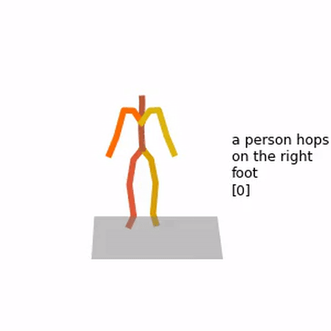
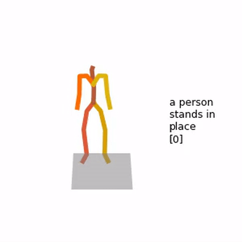

# motion-gen

本仓库用于 HumanML3D 文本到动作推理，当前支持：

- `dit`：单段文本到动作
- `ar_dit`：自回归分段生成，适合动态文本切换
- `ddpm` 采样
- `bert_clip` 文本条件

## 快速上手

### 1. 准备环境

```bash
conda create -n motion python=3.10 -y
conda activate motion
pip install -r requirements.txt
pip install -U "huggingface_hub[cli]"
```

### 2. 下载文本编码器权重

```bash
mkdir -p language_models
hf download distilbert/distilbert-base-uncased  --local-dir ./language_models/distilbert-base-uncased
hf download openai/clip-vit-base-patch32 --local-dir ./language_models/clip-vit-base-patch32
```

### 3. 下载 checkpoint

仓库默认不提交权重文件，`save/` 目录也在 `.gitignore` 中。

模型通过 ModelScope 下载：

```bash
pip install modelscope

modelscope download --model wangyicheng2/motion_gen_models
```

下载完成后，请将模型文件整理到仓库根目录下的 `save/` 目录，并确保以下路径存在：

- `save/ddpm263bert_clip_refiner_dit/model000600000.pt`
- `save/ar_ardit_cfg40_cosine600k_ctx_strongreg_genprefix_mid_steps6/model000550000.pt`

下文示例默认使用上述 `save/` 路径。

### 4. 单句推理示例

`dit` 用于单句文本生成：

```bash
python infer.py \
  --model_path save/ddpm263bert_clip_refiner_dit/model000600000.pt \
  --text_prompt "a person waves both hands" \
  --motion_length 6 \
  --out outputs/sample.npy \
  --mp4_dir outputs/sample_mp4
```

输出文件：

- `outputs/sample.npy`
- `outputs/sample_mp4/sample00_rep00.mp4`

### 5. 动态文本推理示例

`ar_dit` 用于分段自回归生成：

```bash
python infer.py \
  --model_path save/ar_ardit_cfg40_cosine600k_ctx_strongreg_genprefix_mid_steps6/model000550000.pt \
  --dynamic_text_path assets/example_dynamic_text_prompts.txt \
  --out outputs/dynamic_blend.npy \
  --mp4_dir outputs/dynamic_blend_mp4
```

## 模型与入口

- `dit` checkpoint：单句文本生成整段动作
- `ar_dit` checkpoint：分段自回归生成，支持 `texts` / `dynamic_text_path`
- `infer.py`：离线推理，输出 `.npy` 和可选 `.mp4`
- `serve/generate_server.py`：HTTP 服务
- `serve/test_stream_client.py`：流式客户端示例

## 当前仓库支持范围

- `dit`
- `ar_dit`
- DDPM 采样
- `bert_clip` 文本条件
- HumanML3D 解码与 MP4 可视化

## 示例资源

- 单句文本示例：[assets/example_text_prompts.txt](/home/wyc/motion-gen/assets/example_text_prompts.txt)
- 多段动态文本示例：[assets/example_dynamic_text_prompts.txt](/home/wyc/motion-gen/assets/example_dynamic_text_prompts.txt)
- DiT 示例动图：[assets/dit_example.gif](/home/wyc/motion-gen/assets/dit_example.gif)
- DiT 跳跃开合示例：[assets/dit_jumping_jacks.gif](/home/wyc/motion-gen/assets/dit_jumping_jacks.gif)
- DiT 多阶段示例：[assets/dit_multistage_example.gif](/home/wyc/motion-gen/assets/dit_multistage_example.gif)
- AR-DiT 示例动图：[assets/ar_dit_example.gif](/home/wyc/motion-gen/assets/ar_dit_example.gif)

### DiT




### AR-DiT




## 单句推理

```bash
python infer.py \
  --model_path save/ddpm263bert_clip_refiner_dit/model000600000.pt \
  --text_prompt "a person waves both hands" \
  --motion_length 6 \
  --out outputs/sample.npy \
  --mp4_dir outputs/sample_mp4
```

默认行为：

- 自动开启自回归（当 checkpoint 里有 `context_len/pred_len` 时）
- `guidance_param`: `dit=2.5`, `ar_dit=4`
- `num_samples=1`
- `num_repetitions=1`
- `dynamic_text_blend=0.35`
- `autoregressive_motion_blend_frames=12`

输出的 `.npy` 为一个字典：

- `motion`：`[N, J, 3, T]` 的 XYZ 关节序列
- `text`：文本列表
- `lengths`：每个样本的帧数
- `fps`：固定为 `20`

## 动态文本分段

`--dynamic_text_path` 用于在一段动作中按时间切换多段文本条件。

- 文本文件每行一句
- 每一行对应一个自回归窗口
- 总时长自动按 `行数 * pred_len / 20` 计算
- 对于带 `context_len/pred_len` 的 `ar_dit` checkpoint，会自动启用自回归模式，通常不需要再显式传入 `--autoregressive`

示例 [assets/example_dynamic_text_prompts.txt](/home/wyc/motion-gen/assets/example_dynamic_text_prompts.txt)：

```txt
a person stands in place
a person looks down and prepares to pick something up
a person bends forward slowly
a person bends lower and reaches the ground
a person picks something up from the ground
a person starts standing up
a person rises with the object
a person stands and holds the object
```

示例命令：

```bash
python infer.py \
  --model_path save/ar_ardit_cfg40_cosine600k_ctx_strongreg_genprefix_mid_steps6/model000550000.pt \
  --dynamic_text_path assets/example_dynamic_text_prompts.txt \
  --out outputs/dynamic_blend.npy \
  --mp4_dir outputs/dynamic_blend_mp4
```

## 关键参数

- `--guidance_param`：文本约束强度。数值越大，文本约束通常越强。
- `--dynamic_text_blend`：窗口切换时前后文本条件的软过渡系数，范围 `0~1`。
- `--autoregressive_motion_blend_frames`：窗口切换时前一段末尾与后一段开头的动作过渡帧数。
- `--motion_length`：单句推理时的时长，单位秒。
- `--mp4_dir`：指定后额外导出 MP4。

## 启动服务

服务启动后提供：

- `POST /generate`：一次性返回整段结果
- `POST /generate_stream`：按 AR 分段流式返回

```bash
bash serve/run_server.sh save/ar_ardit_cfg40_cosine600k_ctx_strongreg_genprefix_mid_steps6/model000550000.pt --port 8000 --device 0
```

一次性返回整段 `.npy`：

```bash
curl -X POST http://127.0.0.1:8000/generate \
  -H "Content-Type: application/json" \
  -d '{"text":"a person waves both hands"}' \
  --output results.npy
```

服务端也支持多句分段输入，字段名是 `texts`：

```bash
curl -X POST http://127.0.0.1:8000/generate \
  -H "Content-Type: application/json" \
  -d '{
    "texts": [
      "a person stands still",
      "a person raises both arms",
      "a person waves both hands",
      "a person claps hands"
    ]
  }' \
  --output results.npy
```

## 流式服务

`POST /generate_stream` 会在每个自回归窗口完成后，立即返回一行 `NDJSON`。

- 单句模式：按 `motion_length` 生成，多段返回
- 多句模式：传 `texts`，一条句子对应一段
- 每段时长由 checkpoint 的 `pred_len` 和固定 `fps=20` 决定；例如 `pred_len=40` 时一段是 `2` 秒

流式多句示例：

```bash
curl -N -X POST http://127.0.0.1:8000/generate_stream \
  -H "Content-Type: application/json" \
  -d '{
    "texts": [
      "a person stands still",
      "a person raises both arms",
      "a person waves both hands"
    ]
  }'
```

每一行返回的 JSON 包含：

- `segment_index`
- `num_segments`
- `segment_frames`
- `segment_seconds`
- `frames`
- `seconds`
- `fps`
- `text`
- `motion`
- `hml_vec`
- `robot`
- `done`

说明：

- `motion` 是当前这一段的连续 XYZ 结果
- `hml_vec` 是当前这一段可连续拼接的 HumanML 向量表示
- `robot.root_pos` 和 `robot.root_rot_ang` 更适合直接拿去做控制参考
- 这条流式链路是stateful decode，不是“每段独立 decode 再硬拼”

## 流式客户端

自带一个最小客户端脚本 [serve/test_stream_client.py](/home/wyc/motion-gen/serve/test_stream_client.py)：

- 边收流式结果，边保存每段 `segment_XXX.npy`
- 基于 `hml_vec` 做 stateful decode，保证段间连续
- 最后自动拼一个完整 `results.npy`
- 额外导出 `robot` 字段，便于机器人控制使用

多句测试：

```bash
python3 serve/test_stream_client.py \
  --url http://127.0.0.1:8000/generate_stream \
  --texts_path assets/example_dynamic_text_prompts.txt \
  --out_dir outputs/stream_client
```

单句测试：

```bash
python3 serve/test_stream_client.py \
  --url http://127.0.0.1:8000/generate_stream \
  --text "a person waves both hands" \
  --motion_length 8 \
  --out_dir outputs/stream_single
```

输出目录里会有：

- `segment_000.npy`, `segment_001.npy`, ...
- `results.npy`

`results.npy` 除了 `motion/text/lengths/fps` 之外，还包含：

- `hml_vec`：完整拼接后的 HumanML 向量序列
- `robot.joints_xyz`：完整 XYZ 关节序列
- `robot.root_pos`：根节点位置轨迹
- `robot.root_rot_ang`：根节点朝向轨迹

## 性能测试

仓库自带一个最小基准脚本 [serve/benchmark_server.py](/home/wyc/motion-gen/serve/benchmark_server.py)，可以连续请求服务端并统计平均值、P50、P95。

默认同时测试：

- `POST /generate` 的整段返回耗时
- `POST /generate_stream` 的首段返回耗时和整段完成耗时

示例：

```bash
python3 serve/benchmark_server.py \
  --base_url http://127.0.0.1:8000 \
  --runs 20
```

只测流式接口：

```bash
python3 serve/benchmark_server.py \
  --base_url http://127.0.0.1:8000 \
  --mode stream \
  --runs 20 \
  --texts_path assets/example_dynamic_text_prompts.txt
```
